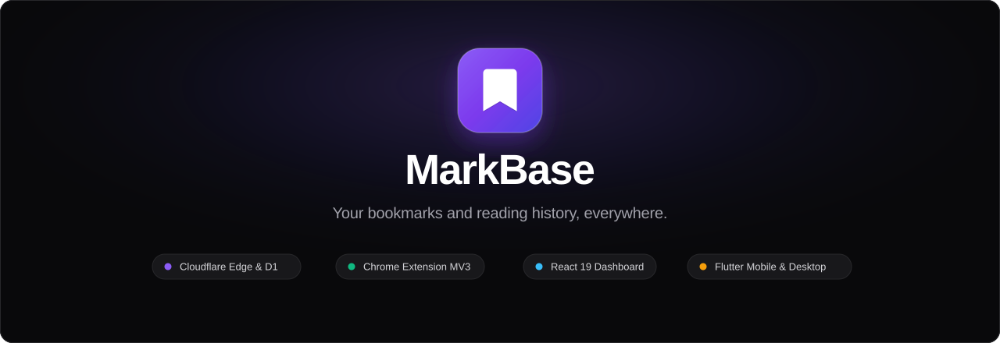
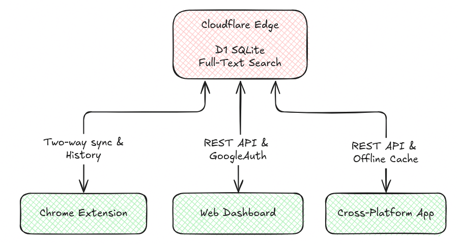

# MarkBase

> **Your bookmarks and reading history, everywhere.**  
> A lightning-fast, private, cross-device sync stack powered by Cloudflare Workers, SQLite D1, Flutter, React, and a Chrome extension.

---

## Architecture Overview

MarkBase is structured as four unified surfaces that stay in continuous two-way sync:



| Component             | Technology                                                                      | Directory                  |
| --------------------- | ------------------------------------------------------------------------------- | -------------------------- |
| **API & Database**    | Cloudflare Python Worker + D1 SQLite                                            | [`api/`](api/)             |
| **Browser Extension** | Chrome/Brave/Edge MV3 · Instant Two-Way Sync · Smart History · Vector Icons     | [`extension/`](extension/) |
| **Web Dashboard**     | React 19 + TypeScript + Tailwind CSS + Lucide Icons + Command Palette (`Cmd+K`) | [`web/`](web/)             |
| **Mobile & Desktop**  | Flutter (Android, Linux, macOS, Windows, iOS, Web)                              | [`app/`](app/)             |

---

## Key Features

### 1. Instant Two-Way Bookmark Sync

- **Sub-500ms Debounce**: Listens directly to all browser bookmark changes (`onCreated`, `onRemoved`, `onChanged`, `onMoved`, `onChildrenReordered`) and immediately pushes diffs to Cloudflare D1.
- **Echo Prevention**: Uses recursion guards so that remote changes applied locally do not bounce back into sync loops.
- **Full Folder Tree**: Synchronizes the Bookmarks Bar, Other Bookmarks, Mobile Bookmarks, and custom nested collections.

### 2. Smart History & Content Extraction

- **Configurable Dwell Time**: Intelligently captures pages you actively read (default **10 seconds**, configurable to 10s, 30s, or 60s) via [`extension/dwell.js`](extension/dwell.js).
- **In-Browser Content Extractor**: Runs readability extraction ([`Defuddle`](extension/capture.js)) in the background to extract clean article text, metadata, and markdown without sending unread tabs to the server.
- **Privacy First**: Automatically skips private IP addresses, `localhost`, and sensitive domains (`bank`, `login`, `auth`, `paypal`, `stripe`).
- **Decoupled Flush**: Queues history clips and flushes them in batches (default **20 seconds**) so heavy reading never blocks bookmark sync.

### 3. Google OAuth 2.0 & Session Bridging

- Sign in with Google on the web dashboard (`resonant-gizmo-488415-b0`).
- The extension automatically picks up your dashboard session via [`extension/session-bridge.js`](extension/session-bridge.js), meaning you sign in with Google once and all surfaces connect.

### 4. Cross-Surface Notes & Collections

- Create and organize quick notes synchronized across the extension popup, mobile app, and web dashboard.
- Full-text search over bookmark titles, URLs, tags, and extracted page contents.

### 5. Polished UI & Vector Icon System

- Built with a modern dark palette (`#09090b` solid base, `#111115` surface, `#8b5cf6` violet accents).
- Strictly vector-based: zero emojis, using Feather / Lucide SVG icons across all interfaces.
- Generous spacing with clean key-value inspector status rows and an in-flow dock bar that eliminates floating overlay clipping.

---

## API Reference

Base URL: `https://markbase-api.spreadsheets600.workers.dev`

All authenticated endpoints require an `Authorization: Bearer <token_or_jwt>` header.

| Endpoint                | Method                    | Description                                            |
| ----------------------- | ------------------------- | ------------------------------------------------------ |
| `/v1/health`            | `GET`                     | Healthcheck and timestamp probe                        |
| `/v1/auth/google`       | `POST`                    | Google ID token verification & session exchange        |
| `/v1/changes`           | `POST`                    | Push local bookmark changes & receive remote delta     |
| `/v1/bookmarks`         | `GET` / `POST` / `DELETE` | List, add, or wipe bookmarks                           |
| `/v1/bookmarks/trash`   | `POST`                    | Soft-delete / trash bookmarks                          |
| `/v1/bookmarks/restore` | `POST`                    | Restore bookmarks from trash                           |
| `/v1/bookmarks/purge`   | `POST`                    | Permanently delete bookmarks                           |
| `/v1/bookmarks/move`    | `POST`                    | Move bookmarks to a folder                             |
| `/v1/search?q=...`      | `GET`                     | Full-text search across bookmarks, notes, and pages    |
| `/v1/notes`             | `GET` / `POST` / `DELETE` | Manage synchronized notes                              |
| `/v1/clip`              | `POST`                    | Ingest extracted page contents & dwell history         |
| `/v1/page?url=...`      | `GET`                     | Retrieve bookmark, content, and history info for a URL |
| `/v1/pages`             | `GET` / `DELETE`          | List or clear reading history                          |

---

## Local Development & Setup

### Prerequisites

- Node.js (v20+)
- Python 3.11+
- Flutter SDK (3.24+)
- Cloudflare Wrangler CLI (`npm install -g wrangler`)

### 1. Cloudflare Worker & D1 Setup

```bash
cd api
npm install
# Initialize local SQLite D1 database
npx wrangler d1 execute markbase-db --local --file=./schema.sql
# Run local worker on http://localhost:8787
npx wrangler dev
```

To deploy to Cloudflare:

```bash
npx wrangler deploy
```

### 2. Chrome Extension Build & Load

```bash
# Build the extraction bundle and zip package
bash scripts/build_extension.sh
```

1. Open Chrome and navigate to `chrome://extensions/`.
2. Enable **Developer mode** in the top right.
3. Click **Load unpacked** and select the [`extension/`](extension/) directory.
4. Open the extension popup and click "Sign in with Google" to connect.

### 3. Web Dashboard Build

```bash
cd web
npm install
npm run dev        # Local dev server on :5173
npm run build      # Production build straight into api/public/
```

### 4. Flutter App (Mobile & Desktop)

```bash
cd app
flutter pub get
flutter analyze
flutter test
flutter run        # Run on Linux desktop, connected Android phone, or Chrome
```

To build a standalone APK for Android:

```bash
flutter build apk --release
```

---

## Automation & CI/CD

Workflows are configured under [`.github/workflows/`](.github/workflows/):

- **`ci.yml`**: Runs on push and pull requests to `main`:
  - Python worker compile check (`py_compile`)
  - Web dashboard typecheck & production build (`tsc && vite build`)
  - Chrome extension syntax checks (`node --check`) and artifact generation
  - Flutter code analysis, widget tests, and web compilation
- **`release.yml`**: Automatically builds extension packages (`.zip`) and release binaries upon pushing version tags (`v*`).

---

## Git Commit Convention

All commits in MarkBase follow the [Conventional Commits specification](https://www.conventionalcommits.org/):

| Type        | Purpose                                                         |
| ----------- | --------------------------------------------------------------- |
| `feat:`     | A new feature or major capability                               |
| `fix:`      | A bug fix or defect resolution                                  |
| `docs:`     | Documentation changes only                                      |
| `style:`    | Formatting, whitespace, or visual polish (no logic change)      |
| `refactor:` | Code restructuring that neither fixes a bug nor adds a feature  |
| `perf:`     | Performance improvements                                        |
| `test:`     | Adding or correcting unit/widget/integration tests              |
| `ci:`       | GitHub Actions workflow, runner, or build configuration changes |
| `chore:`    | Dependency bumps, maintenance, or tooling adjustments           |

---

## License

MIT License. Designed and crafted for private, stateless, dependable bookmark and reading synchronization.
